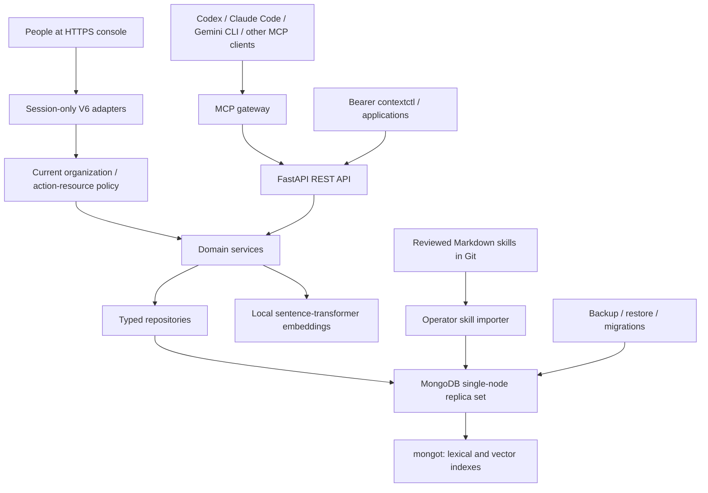

# Architecture

Agent Context Platform provides durable knowledge to coding agents through one
MCP capability interface, versioned bearer APIs and the session-only human console. The agent chooses what to
retrieve or save; the platform validates, authorizes, stores, and ranks it.

## Layers and interfaces

FastAPI routes parse typed requests and invoke services. Domain services own
authorization, lifecycle, review, provenance, and orchestration. Repositories
validate persistence models, apply resource filters, and perform MongoDB queries
and conditional writes. Pure retrieval modules rank, deduplicate, and enforce
token budgets independently of database access.

MCP and ordinary CLI commands call the REST API. The stdio MCP process has no
database credentials. Remote clients share `/mcp`, served by the API's
Streamable HTTP gateway. Operator-only commands such as importing skills,
provisioning identities, adopting tenants, migrating, backing up, and restoring access MongoDB directly
inside the private deployment network.

| Domain | Responsibility | Public interface |
| --- | --- | --- |
| Knowledge | Skills, projects, durable project context, explicit memory, unified retrieval | `/api/v1`, knowledge MCP tools |
| Creator/content | Preferences, themes, ideas, briefs, drafts, versions, review, manual export/receipts, metrics | `/api/v2`, content MCP tools |
| Research | Registered sources, immutable snapshots, documents, evidence, claims, briefs, reviewed candidates and promotion | `/api/v3`, research MCP tools |
| Gateway | Client identity, credentials, project bindings, sessions, provenance, audit, revision/retry controls | `/api/v4`, capability/session MCP tools |
| Onboarding | Reusable permission templates copied on assignment and client integration metadata | `/api/v5`, operator integration commands |
| Human console | Private identity, memberships, bounded governance, sponsored clients, thin domain adapters and authorized summaries | Session-only `/api/v6`, `/console/` |

The API version numbers identify compatibility surfaces. They do not require
separate services, databases, or agent-specific implementations.

## Knowledge and evidence

Canonical skills are reviewed Markdown files in Git. Their imported runtime
metadata and chunks belong to one organization; there is no null-org shared corpus. Importing an unchanged
version is idempotent; changed content under the same version is refused. An
imported new version supersedes the active representation while retaining history.

Project context records verified facts, architecture decisions, contracts, and
conventions within an explicit project. Memories are saved intentionally and can
be organization-global, project-scoped, agent-scoped, or project-agent-scoped.
Private agent scopes retain verified client ownership even for human managers. Corrections can
supersede older records. Actor metadata identifies the authenticated writer.

Research keeps source versions and locators through normalized documents,
chunks, citations, claims, and briefs. Retrieval relevance and descriptive source
classes do not establish factual confidence. Supporting and contradicting evidence
remain visible. Candidates require an explicit review and a separate authorized
promotion before becoming memory or project context. Generated skill patches
remain proposals until reviewed, changed in Git, and imported normally.

The content system combines authorized source material with creator preferences
and content history. It provides deterministic planning and review data; the
calling agent writes prose. Approval is bound to a revision. Export is manual,
and the included publisher records a human-confirmed publication without sending
content to an external platform.

## Retrieval and storage

The service embeds a query locally and searches authorized sources with lexical
and vector methods. Tenant and action-specific resource filters apply before
candidate selection, followed by defensive ownership checks. Signed pagination
cursors bind organization, filter and policy context. It combines signals, filters again, removes overlapping
results, and includes complete chunks that fit the token budget. Unified knowledge
search covers skills, project context, and memory. Research and creator content
have their own retrieval interfaces and budgets.

MongoDB is the durable system of record. The application connects to `mongod`,
which coordinates with `mongot`; it does not query `mongot` directly. Vectors and
their model metadata are stored with documents. Search indexes are derived state
and can be rebuilt after restoring a backup. Backups include all database
collections, historical versions, identities, grants, and provenance.

## Trust and deployment

Random API keys and opaque browser sessions are stored as hashes; human
passwords use Argon2id and MFA seeds use an installation-mounted encryption
keyring. Managed key/client rights intersect current verified sponsor, team and
parent grants per action/resource. Human roles require explicit assignments;
read-A/write-B stays coupled. Governance mutation and audit/outbox share a
transaction and policy-anchor fence. Ordinary domain audit remains best-effort.
These checks are enforced server-side; client trust prompts and local tool filters do
not widen those grants. Mutable records use expected revisions to reject stale
updates. Gateway controls bound request rates, concurrency, execution times, and
retry reservations. Retrieved text is labeled data and never silently becomes
trusted instructions.

Compose defaults to one API process, one replica-set member, and one search
process. Database and search ports are private; the API binds to loopback.
The [console overlay](dashboard-deployment.md) removes API host ports and serves
console, session API, bearer APIs and MCP on one exact HTTPS origin. Cookies and
bearer authentication stay separate. Logical tenant isolation does not protect
data from trusted installation DB/backup operators; raw archives and shared
metrics remain operator-only. Remote MCP/API access requires HTTPS. This
topology has no automatic host failover: recovery requires an independently stored
backup and a tested restore. Embedding inference is local, while your agent's
model provider remains a separate data boundary.

URL and repository ingestion check public destinations and bound downloads,
but validation and the network connection use separate DNS resolutions. Enforce
an outbound network policy that blocks private and metadata destinations when
enabling ingestion with untrusted source submitters. See [research.md](research.md).

Read [onboarding.md](onboarding.md) for source navigation,
[deployment.md](deployment.md) for configuration, [retrieval.md](retrieval.md)
for ranking contracts, and [research.md](research.md) for evidence workflows.
